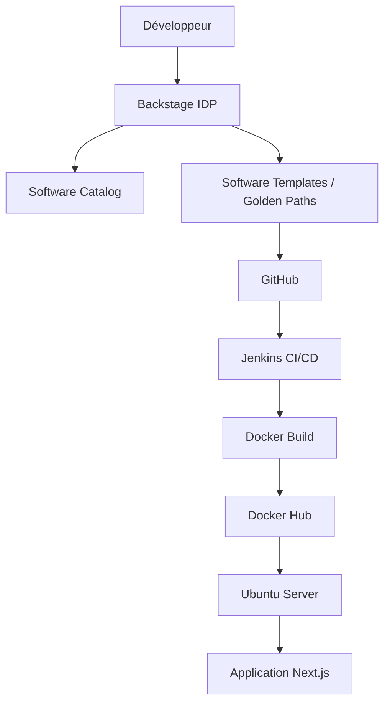

# Platform Engineering Demo — Backstage

**Internal Developer Platform (IDP) | Golden Paths | CI/CD | Docker**


## 1. Présentation du projet

Ce projet consiste à mettre en place une démonstration de **Platform Engineering** basée sur Backstage afin de simplifier et standardiser le cycle de vie des applications.

L'objectif est de proposer aux développeurs une plateforme centralisée permettant de découvrir les services, de générer des projets à partir de modèles standardisés (*Golden Paths*), de consulter leur documentation et de suivre leur intégration dans une chaîne CI/CD.

La démonstration s'appuie sur une application Portfolio développée avec Next.js, intégrant GitHub, Jenkins, Docker Hub et un serveur Ubuntu.

**Dépôt GitHub :**
https://github.com/ferid-saad/backstage-demo

## 2. Objectifs

- Mettre en place un portail développeur centralisé avec Backstage.
- Standardiser la création de projets grâce aux Software Templates.
- Centraliser les informations des composants dans le Software Catalog.
- Intégrer Jenkins pour l'automatisation du pipeline CI/CD.
- Conteneuriser les applications avec Docker.
- Publier les images sur Docker Hub.
- Déployer une application sur un serveur Ubuntu.
- Centraliser la documentation technique avec TechDocs.

## 3. Architecture technique



### Composants principaux

| Composant | Rôle |
|---|---|
| Backstage | Portail développeur et plateforme IDP |
| Software Catalog | Inventaire centralisé des composants |
| Software Templates | Génération standardisée des projets |
| GitHub | Gestion du code source |
| Jenkins | Automatisation CI/CD |
| Docker | Construction et exécution des conteneurs |
| Docker Hub | Registre des images Docker |
| Ubuntu Server | Environnement de déploiement |
| TechDocs | Documentation technique |

## 4. Technologies utilisées

- **Platform Engineering :** Backstage
- **Frontend :** React, Next.js, TypeScript
- **CI/CD :** Jenkins
- **Versioning :** Git et GitHub
- **Containerisation :** Docker, Docker Compose
- **Registry :** Docker Hub
- **Infrastructure :** Ubuntu Server
- **Documentation :** MkDocs et TechDocs

## 5. Structure du dépôt

```text
backstage-demo/
│
├── app-config.yaml
├── package.json
├── yarn.lock
├── README.md
│
├── packages/
│   ├── app/
│   └── backend/
│
├── demo-data/
│   ├── templates/
│   │   ├── portfolio-nextjs-template/
│   │   └── nodejs-paved-road/
│   │
│   ├── portfolio-nextjs/
│   ├── payment-gateway-service/
│   ├── devsecops-portfolio/
│   └── ...
│
└── ...
```

## 6. Installation et démarrage

### Prérequis

- Node.js
- Yarn
- Git
- Docker (pour les opérations de conteneurisation)
- Accès aux services GitHub et Jenkins selon les fonctionnalités utilisées

### Cloner le dépôt

```powershell
git clone https://github.com/ferid-saad/backstage-demo.git
cd backstage-demo
```

### Installer les dépendances

```powershell
yarn install
```

### Configurer les variables d'environnement

La configuration utilise des variables d'environnement pour gérer les informations d'authentification :

- `BACKEND_SECRET`
- `GITHUB_TOKEN`
- `GHE_TOKEN` (selon la configuration GitHub Enterprise)
- `JENKINS_TOKEN`
- `K8S_TOKEN`

Ces valeurs doivent être configurées dans l'environnement d'exécution. Elles ne doivent jamais être inscrites en clair dans les fichiers versionnés ni publiées sur GitHub.

### Démarrer Backstage

```powershell
yarn start
```

Portail Backstage :

http://localhost:3000

Backend :

http://localhost:7007

## 7. Golden Paths — Software Templates

Deux modèles de génération sont disponibles.

### 7.1 Portfolio Next.js

Template : `portfolio-nextjs-template`

Fonctionnalités :
- Saisie du nom du projet.
- Définition de la description.
- Définition de l'équipe responsable.
- Génération du squelette Next.js à partir du dossier `skeleton`.
- Intégration d'un Dockerfile et d'un fichier Docker Compose.
- Génération du fichier `catalog-info.yaml`.

### 7.2 Node.js Paved Road

Template : `nodejs-paved-road`

Fonctionnalités :
- Saisie du nom du dépôt.
- Choix du type de base de données : PostgreSQL, MySQL ou MongoDB.
- Option de monitoring.
- Génération d'un squelette de microservice Node.js / Express.
- Journalisation de la génération et pause de démonstration.

Ces modèles constituent une base de standardisation des pratiques de développement.

## 8. Software Catalog

Le Software Catalog centralise les informations sur les composants logiciels.

Il permet notamment de consulter :
- Le nom et la description du composant.
- L'équipe responsable.
- Le dépôt GitHub associé.
- Les liens vers l'application déployée.
- Les informations de documentation.
- Les informations d'intégration Jenkins lorsqu'elles sont configurées.

Exemple de composant : `portfolio-nextjs`.

## 9. Pipeline CI/CD avec Jenkins

Jenkins assure l'automatisation du processus de livraison de l'application Portfolio.

Le workflow de démonstration comprend :

1. Récupération du code source.
2. Préparation de l'environnement de build.
3. Construction de l'application Next.js.
4. Construction de l'image Docker.
5. Publication de l'image sur Docker Hub.
6. Déploiement sur le serveur Ubuntu.
7. Vérification de la disponibilité de l'application.

Jenkins :

http://192.168.50.88:8080

## 10. Docker et déploiement

L'application Portfolio Next.js est conteneurisée avec Docker.

Les fichiers associés comprennent :
- `Dockerfile`
- `docker-compose.yml`
- `.dockerignore`

Image Docker Hub :

`feridsaad/portfolio-nextjs`

Serveur de démonstration :

`192.168.50.88`

Application déployée :

http://192.168.50.88:3001

Cette adresse appartient à l'environnement de laboratoire et nécessite un accès au réseau correspondant.

## 11. Documentation technique — TechDocs

TechDocs permet de rapprocher la documentation technique du code source.

La documentation du projet comprend notamment :
- La présentation de l'architecture.
- Les informations techniques.
- Les éléments nécessaires à la compréhension du déploiement.

La génération locale du site de documentation a été réalisée avec MkDocs et `mkdocs-techdocs-core`. L'affichage final dans l'interface Backstage reste à valider.

## 12. Scénario de démonstration

Le scénario proposé pour présenter la plateforme est le suivant :

1. Accéder au portail Backstage.
2. Présenter le Software Catalog.
3. Ouvrir les Software Templates.
4. Générer un projet Portfolio Next.js.
5. Examiner les fichiers générés.
6. Présenter le dépôt GitHub.
7. Déclencher ou présenter le pipeline Jenkins.
8. Examiner la construction de l'image Docker.
9. Vérifier la publication sur Docker Hub.
10. Accéder à l'application déployée sur Ubuntu.
11. Présenter la documentation technique.
12. Modifier le projet et illustrer l'évolution du pipeline CI/CD.

## 13. Livrables du projet

| N° | Livrable |
|---:|---|
| 1 | Template Backstage |
| 2 | Dépôt Git généré |
| 3 | Application Portfolio Next.js |
| 4 | Dockerfile |
| 5 | docker-compose.yml |
| 6 | Image publiée sur Docker Hub |
| 7 | Documentation technique |
| 8 | Démonstration du workflow Backstage |
| 9 | Démonstration de l'évolution du projet et de la réexécution du pipeline |

## 14. Conclusion

Cette démonstration illustre l'apport du Platform Engineering dans la simplification du travail des développeurs.

En centralisant les outils, en proposant des modèles standardisés et en automatisant le cycle de livraison, Backstage constitue une base pour construire une Internal Developer Platform évolutive.

Le projet met en évidence le lien entre expérience développeur, standardisation, automatisation CI/CD et déploiement applicatif.

---

**Projet :** Platform Engineering — Backstage Demo
**Dépôt :** https://github.com/ferid-saad/backstage-demo